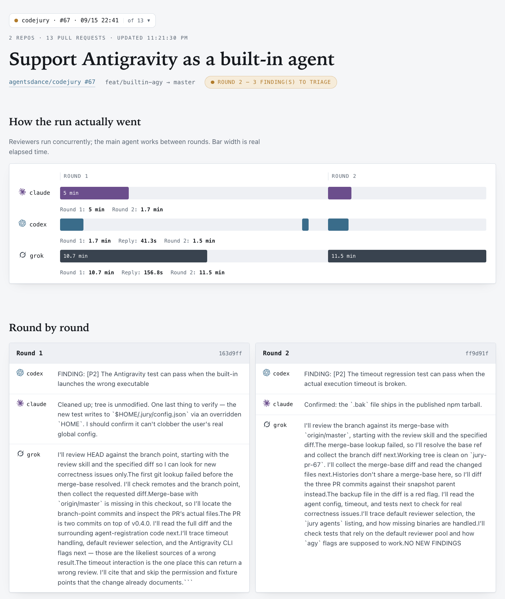
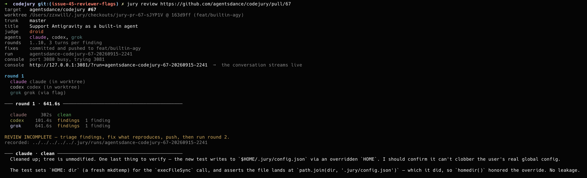
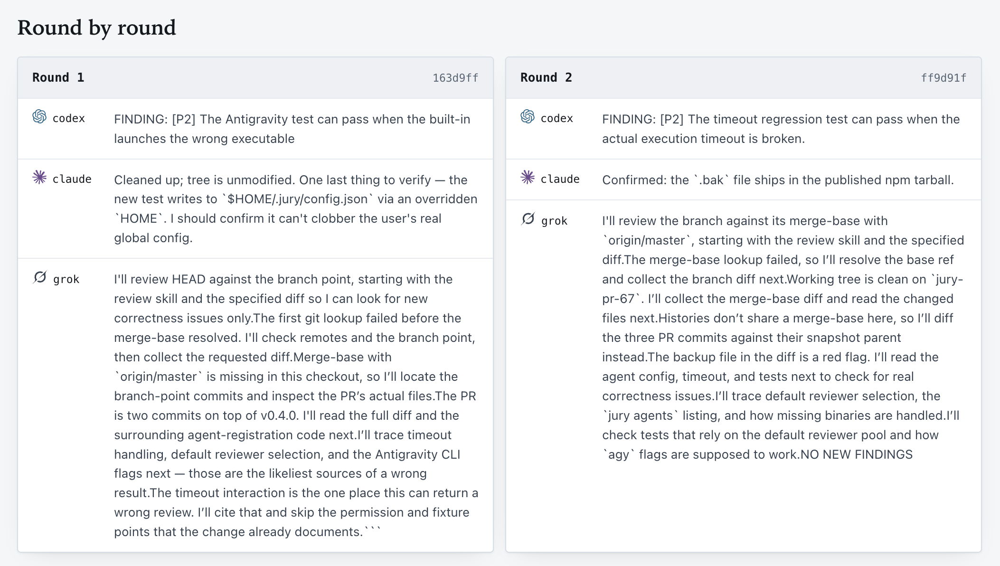
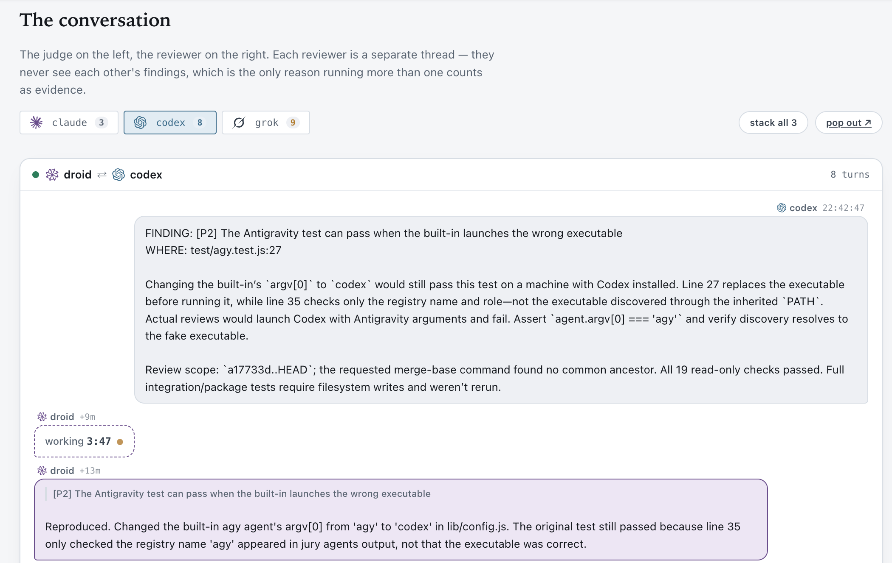

# Code Jury

[English](README.md) | **简体中文**

**多个 AI 独立审查，一位裁判核实，让代码审查过程清晰可追踪。**

[](https://github.com/agentsdance/codejury/actions/workflows/ci.yml)
[](https://www.npmjs.com/package/@agentsdance/codejury)
[](LICENSE)

Code Jury 是一个在本地运行的命令行工具（CLI）。它让多个编程智能体独立审查拉取请求（PR），
再由一位裁判复现发现的问题、实施修复，并请审查者再次检查。
你可以在浏览器控制台中跟踪每轮对话；提示词、审查报告、裁决和 Git 提交都会保存在本地。
它也支持将跨仓库的关联 PR 作为一个任务协同审查。

[下载交互式控制台演示](docs/console-demo.html)，然后在浏览器中打开该 HTML 文件。
演示使用示例数据，不会启动智能体。

## 支持的编程智能体

|  | 编程智能体 | CLI 名称 | 默认角色 |
|:--:|---|---|---|
|  | OpenAI Codex | `codex` | 主智能体（裁判） |
|  | Anthropic Claude Code | `claude` | 审查者 |
|  | xAI Grok | `grok` | 审查者 |
|  | Factory Droid | `droid` | 审查者 |
|  | Google Antigravity | `agy` | 审查者 |
|  | OpenCode | `opencode` | 按需启用 |
|  | Qwen Code | `qwen` | 按需启用 |
|  | GitHub Copilot CLI | `copilot` | 按需启用 |
|  | Cursor Agent CLI | `cursor` | 按需启用 |
|  | Sourcegraph Amp | `amp` | 按需启用 |
|  | Moonshot Kimi Code CLI | `kimi` | 按需启用 |
|  | TRAE CLI | `trae` | 按需启用 |

**按需启用**的智能体完整支持审查者和裁判两种角色，但不在默认候选列表中，
因此首次安装时无需准备所有 CLI。直接通过名称选择即可，无需修改配置。
安装命令见[内置智能体](#内置智能体)。

每个智能体的 CLI 都需要单独安装并完成身份验证。运行 `jury agents`，
即可查看已启用的智能体中哪些已安装（`ok`）、哪些尚未安装（`MISSING`）。
任何已启用的智能体都可以通过 `--jury <name>` 指定为审查者，或通过 `--judge <name>` 指定为主智能体。
显式指定时，同一个智能体可以在不同会话中分别担任两种角色，详见下文。
你还可以通过[自定义智能体配置](docs/configuration.md#custom-agent)添加其他 CLI。

## 快速开始

你需要 Node.js 20+、Git，以及已完成身份验证的编程智能体 CLI。
审查 GitHub PR 还需要 [GitHub CLI](https://cli.github.com/)（运行 `gh auth login` 登录），
以及能够克隆目标仓库的 Git 凭据。
如果只安装了一个受支持的 CLI，Jury 会自动让它同时担任裁判和审查者；
如果安装了两个，则随机分配一个作为裁判、另一个作为审查者。显式指定的角色设置优先。
智能体的安装、登录、订阅和使用费用均由各自的服务提供方管理，与 Code Jury 分开。

即使安装了其他 CLI，也可以明确让 Codex 同时担任审查者和裁判：

```sh
jury review <pr-url> --reviewer codex --judge codex --push=false
```

这一设置只对本次运行生效，不会修改全局默认值。审查者和裁判使用不同的提示词和服务端会话：
新一轮任务的首次审查不会恢复裁判的对话。Codex 的审查和审查者回复使用 `read-only` 权限；
裁判执行任务和恢复会话时使用 `workspace-write` 权限。
审查流程只交换问题、裁决和回复，不会传递裁判的私有会话历史。
两种角色仍然能够看到同一个工作区，以及流程中已经定论的问题。

`jury review --resume <slug>` 会恢复已保存的角色；`jury reply --run <slug>`
会将回复发送到已保存的审查者会话，不会发送到裁判会话。
请使用与原始运行相同的 `--dir` 和目标参数。审查者列表中也可以包含其他智能体。
每条发出的回复都会保存其文本，以便控制台将裁判的消息与审查者的回答一起回放。
如果没有可用的审查会话 ID，回复会启动新会话，Jury 会保存新 ID 供后续回复使用；新的审查则会替换该回复会话。
如果某条回复在更新的审查完成后才结束，其回答仍会保留在日志中，但不能替换更新审查的会话，
即使该回复是基于旧快照准备的也一样。
并发回复也会保留基于同一快照最先被接受的会话变更；被放弃的回复或未返回 ID 的新会话回复不会覆盖可用会话。

独立会话不等于模型多样性，也不能保证判断独立或审查质量。
如果需要不同视角，建议选择不同的智能体。默认审查者候选列表仍会排除裁判；只有一个 CLI 时的自动回退行为保持不变。

```sh
npm install -g @agentsdance/codejury
jury agents
jury review https://github.com/OWNER/REPO/pull/123 --push=false
```

将示例 URL 替换为你的 PR 链接。`jury agents` 会列出已配置的可执行程序和角色；
它只检查是否安装，不检查登录状态或可用额度。审查前，请通过各智能体自己的 CLI 完成身份验证。
启动智能体前，Jury 会显示本次选定的裁判和审查者；自动分配结果也会保存，供回复和恢复运行时使用。

**审查过程可能修改文件并创建 Git 提交，默认会推送到远程分支。**
`--push=false` 只禁用 Jury 的推送操作，不会启用只读模式，也不是智能体沙箱。
通过单个 PR URL 创建的检出目录是临时目录，任务结束后会被删除。
如果希望长期保留仅在本地的修复，请在自己的仓库检出目录中运行，不传入 URL。详见[状态与保留策略](docs/usage.md)。
控制台会自动打开，并在审查结束后继续运行；使用完毕后按 Ctrl-C 退出。
只使用终端时，可添加 `--web=false`。

```text
jury agents                           # 查看已安装的可执行程序和已配置的角色
jury review <pr-url> --push=false      # 审查并修复，但不推送
jury review <pr-url>                   # 审查、修复、提交并推送
jury runs --dir ""                     # 列出已保存的 URL 审查任务
jury --web-only --dir ""                # 重新打开这些任务的控制台
jury help review                       # 查看完整的审查选项
```

`jury <pr-url>` 是 `jury review <pr-url>` 的简写。也可以不全局安装，直接运行：
`npx @agentsdance/codejury review <pr-url> --reviewer claude --push=false`。

通过 `--language en` 或 `--language zh-CN` 选择生成文本的语言。
Jury 会在后续轮次、回复和恢复运行时保留这一设置；再次传入该参数即可切换。
示例见[回复语言](docs/usage.md#response-language)。

## Codex 桌面插件

在 Codex 中使用你自己的编程智能体审查 PR。通过 GitHub 安装：

```sh
codex plugin marketplace add agentsdance/codejury
codex plugin add codejury@codejury
```

新建一个 Codex 对话，选择 **CodeJury**，然后输入：

> 审查 https://github.com/OWNER/REPO/pull/123

请替换为你的 PR 链接。审查在本地运行，默认会将修复推送到 PR。
如果不希望推送，请明确要求将修复保留在本地。
前置条件、智能体选择和已保存审查的使用方式见[设置与使用指南](docs/codex-plugin.md)。

## Claude Code 插件

Code Jury 也提供 [Claude Code 插件](https://code.claude.com/docs/en/plugins)。
将本仓库添加为插件市场并安装：

```sh
claude plugin marketplace add agentsdance/codejury
claude plugin install codejury@codejury
```

在会话中运行 `/codejury:review <pr-url>`，插件会调用 `jury review`；
插件先检查全局 `jury`；未安装时通过 npm 全局安装，不使用独立目录或临时副本。
在 Claude Code 中，插件始终设置 `--judge claude --reviewer claude`，
对新任务和恢复的任务都会覆盖传入或已保存的角色选择。两种角色使用独立会话。
其他显式传入的参数优先于默认的 `--web=true` 和 `--push=false`。
Claude 会分享浏览器控制台链接，在审查结束时总结问题和裁决，并保持控制台运行。
传入 `--web=false` 可禁用控制台。插件要求提供 PR URL；如果未提供，Claude 会先询问再开始。
插件还包含 `codejury` 技能，便于手动执行审查循环。
智能体 CLI 仍需单独安装并完成身份验证。`--push=false` 只禁用推送，不会使审查变为只读。
单个 PR 的检出目录是临时目录，清理时会删除尚未推送的修复。
前置条件、更新方式和本地安装检查见[插件指南](plugin/README.md)。

## 截图

以下展示了对 Code Jury PR #67 的审查：Droid 担任裁判，Claude、Codex 和 Grok 担任审查者。
控制台显示每个智能体的耗时，以及各轮审查中发现的问题。



<details>
<summary>终端审查输出</summary>

CLI 显示目标 PR、裁判、审查者、控制台 URL 和第一轮结果。



</details>

<details>
<summary>逐轮查看问题</summary>

对比每位审查者针对后续提交给出的报告。



</details>

<details>
<summary>裁判与审查者的对话</summary>

从审查者报告的问题出发，跟踪裁判的复现过程和回应。



</details>

## 工作原理

1. 解析 PR 的目标分支和最新提交，准备独立的检出目录。
2. 并行运行选定的审查者，每位审查者独立报告问题。
3. 由一位裁判调查每个问题并记录裁决。接受问题时，必须提供复现证据和测试说明。
4. 提交修复；除非禁用推送，否则推送到来源分支。向每位审查者反馈其提出的问题的处理结果。
5. 重复上述流程，直到审查者达成一致且没有待处理问题，或达到轮次上限。

智能体达成一致只是审查结果，不能证明代码没有缺陷。证据会被记录下来，供你检查。
裁判提供的测试证据也不等于独立认证。
默认最多进行 10 轮审查，每个有争议的问题最多进行三次交流。

如果缺少选定智能体的可执行程序，任务会在启动智能体前停止。
如果审查者异常退出，循环会在当前审查或回复轮次结束后停止；失败状态会被保存，绝不会被视为审查通过。
解决安装、登录或额度问题后，使用相同的目标参数并添加 `--resume <slug>` 即可恢复。

## 选择审查者

```sh
jury review <pr-url> --reviewer claude --reviewer grok
jury review <pr-url> --jury claude,grok
jury review <pr-url> --judge claude --reviewer droid --push=false
```

使用已安装并完成身份验证的 Antigravity CLI 作为审查者：

```sh
jury review <pr-url> --jury agy --push=false
```

`jury agents` 默认会列出 `agy`。如果其可执行程序不在 `PATH` 中，会标记为 `MISSING`。
Antigravity 使用非交互式输出模式运行，并自动批准工具调用；详见[配置与权限](docs/configuration.md)。

为所有仓库设置默认裁判：

```bash
jury agents judge claude    # 保存全局默认裁判
jury agents judge          # 查看已保存的默认值
jury agents judge --reset  # 清除该设置
```

设置保存在 `~/.jury/config.json` 中。优先级依次为：显式 `--judge`、仓库中的 `main` 角色、
全局设置，最后是 Codex。`jury agents` 会显示当前目录中实际生效的角色。
裁判必须在目标仓库中处于启用状态；自定义智能体命令仍需在每个使用它的仓库中配置。

`--reviewer` 和 `--jury` 支持重复传入，也支持使用逗号分隔多个名称。
默认审查者候选列表会排除选定的裁判；显式让同一智能体兼任两种角色的方式见[快速开始](#快速开始)。
未显式选择时，会使用已启用且具有审查者角色的智能体；请禁用不可用的智能体，或显式选择已安装的审查者。

也可以为所有仓库保存默认审查者：

```bash
jury agents jury claude             # 默认只由 Claude 审查
jury agents jury claude,droid,amp   # 选择多个，也可包含按需启用的智能体
jury agents jury                    # 查看列表，或在交互式终端中通过复选列表选择
jury agents jury --reset            # 恢复内置审查者候选列表
```

设置与全局裁判一起保存在 `~/.jury/config.json` 中。
优先级依次为：`--reviewer` / `--jury`、仓库中的 `reviewer` 角色、已保存的默认审查者，最后是内置候选列表。
保存列表后会关闭自动角色分配，与使用 `--jury` 的效果相同。裁判不会进入自己的默认审查者列表。
如果已保存的审查者后来被卸载或在仓库中禁用，任务会报错并指出相关设置，不会悄悄减少审查者数量后继续执行。

无需修改智能体自身的配置，即可选择它运行时使用的模型：

```bash
jury agents model claude opus                 # 保存默认模型
jury review <pr-url> --model codex=gpt-5.5    # 仅本次运行生效
```

各智能体的参数及优先级规则见[模型配置](docs/configuration.md#models)。

### 内置智能体

| 名称 | 产品 | 安装命令 | 默认角色 |
|---|---|---|---|
| `codex` | OpenAI Codex | `npm i -g @openai/codex` | 裁判 |
| `claude` | Anthropic Claude Code | `npm i -g @anthropic-ai/claude-code` | 审查者 |
| `grok` | xAI Grok | `npm i -g @vibe-kit/grok-cli` | 审查者 |
| `droid` | Factory Droid | `curl -fsSL https://app.factory.ai/cli \| sh` | 审查者 |
| `agy` | Google Antigravity | `curl -fsSL https://antigravity.google/cli/install.sh \| bash` | 审查者 |
| `qwen` | Qwen Code | `npm i -g @qwen-code/qwen-code` | 按需启用 |
| `copilot` | GitHub Copilot CLI | `npm i -g @github/copilot` | 按需启用 |
| `opencode` | OpenCode | `npm i -g opencode-ai` | 按需启用 |
| `cursor` | Cursor Agent CLI | `curl https://cursor.com/install -fsS \| bash` | 按需启用 |
| `amp` | Sourcegraph Amp | `npm i -g @sourcegraph/amp` | 按需启用 |
| `kimi` | Moonshot Kimi Code CLI | `npm i -g @moonshot-ai/kimi-code` | 按需启用 |
| `trae` | TRAE CLI (`traecli`) | `sh -c "$(curl -fsSL https://trae.cn/trae-cli/install_v2.sh)"` | 按需启用 |

**按需启用**的智能体完整支持 `--reviewer`、`--jury`、`--judge` 和 `jury agents judge`，
但不会加入默认候选列表，因此首次安装时无需准备所有 CLI：

```sh
jury review <pr-url> --jury qwen,amp        # 无需修改配置即可使用
jury agents judge qwen                      # 也可将其保存为默认裁判
```

每个智能体自行处理身份验证，具体操作请参阅其文档。
`jury agents` 会显示哪些智能体已安装、如何安装缺少的智能体，以及哪些审查者**没有只读模式**。
对于没有只读模式的审查者，只有审查提示词要求其不写入，工具本身并不限制写入。

添加内置智能体只需修改一个文件，详见[添加内置智能体](docs/configuration.md#adding-a-built-in-agent)。

可以参考 [`jury.config.example.json`](jury.config.example.json) 在目标仓库中配置智能体。
实际执行边界和自定义命令见[配置与权限](docs/configuration.md)。

## 一起审查关联 PR

```sh
jury review https://github.com/acme/api/pull/12 https://github.com/acme/client/pull/34 \
  --reviewer claude --push=false
```

每位审查者都能看到所有传入的 PR、它们的描述和各自的检出目录。
裁判可以在对应分支中修复跨仓库问题；发现的问题和提交始终与各自的 PR 关联。
配置取自第一个 PR。请不要传入 `--trunk`，因为每个 PR 都有自己的目标分支。
恢复运行、GitLab 限制和状态目录的说明见[使用与故障排查](docs/usage.md)。

## 数据与权限

- Jury 在你的机器上运行智能体 CLI。这些智能体可能根据你的账户设置和服务条款，将源代码、提示词和输出发送给各自的服务提供方。
- 智能体会继承进程环境。仓库配置可以定义可执行命令；在不熟悉的仓库中运行前，请先检查配置。
- 只读限制的实际效果取决于每个智能体配置的权限。部分内置或自定义智能体使用较宽松的审批设置。Jury 不是安全沙箱。
- 提示词、对话记录、发现的问题和运行元数据保存在选定的状态根目录中，可能包含敏感源代码或其他资料；分享前请先检查。
- 控制台绑定到 `127.0.0.1`，没有登录认证，请仅在本地使用。详见 [SECURITY.md](SECURITY.md)。

## 项目状态与贡献

Code Jury 尚未发布 1.0 版本。CLI 的变更记录见[更新日志](CHANGELOG.md)。
CI 在 Linux 和 macOS 上测试 Node.js 20、22 和 24，并包含全新安装 npm 包后的验证。
Windows 支持仍处于实验阶段，尚未在该平台验证完整工作流程。
CI 使用本地测试替身模拟外部智能体服务，因此与服务提供方 CLI 的兼容性仍取决于你安装的版本。
Go 控制台原型保留用于开发；正式支持的分发形式是 npm CLI。

[报告问题](https://github.com/agentsdance/codejury/issues/new/choose) ·
[参与贡献](CONTRIBUTING.md) · [报告安全问题](SECURITY.md) ·
[案例分析](CASE-STUDY.md) · [已知限制](TODO.md)

## 赞助

本项目获得 OpenAI [Codex for Open Source](https://openai.com/form/codex-for-oss/)
计划支持，享有 ChatGPT Pro（20x）访问权限。

## 许可证

[MIT](LICENSE)。

### OpenCode

安装 [OpenCode](https://opencode.ai/docs/cli/)（`npm install -g opencode-ai`），
并运行 `opencode auth login` 配置服务提供方。已验证的 CLI 版本为 1.18.31。
可以通过 `--reviewer opencode` / `--jury opencode`、`--judge opencode`
或 `jury agents judge opencode` 选择它。

审查使用 `opencode run --agent plan --format json`，禁止编辑、任务委派和访问工作目录之外的内容。
plan 智能体可以通过获准的 shell 命令检查 Git；这些 CLI 工具权限不等于操作系统沙箱，
本地 OpenCode 配置也必须可信。裁判使用 build 智能体和 `--auto` 来编辑文件并运行检查，
显式拒绝的权限仍然有效。两种角色都在目标工作区中运行。
回复会携带相关问题的上下文启动新会话；Jury 不会恢复最近一次无关对话。
只解析助手文本事件；格式错误的输出、错误事件、空输出、异常退出和超时都不能使审查通过。

已验证的 CLI 版本、登录命令、权限边界和会话处理方式见[智能体配置](docs/configuration.md#authentication-versions-and-conversations)。
包括 OpenCode 在内的新智能体均需按需启用；请显式选择，或在仓库配置中启用。
